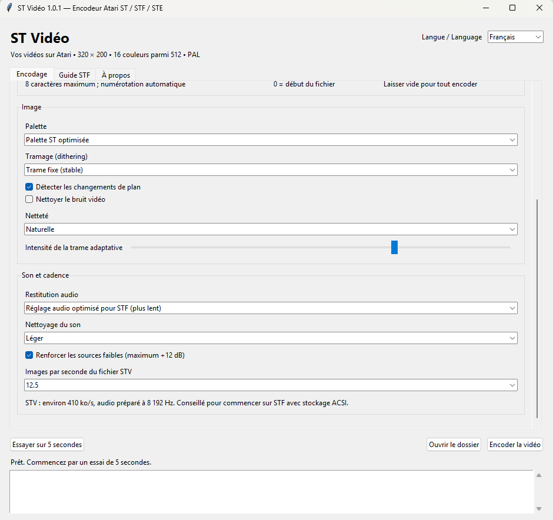
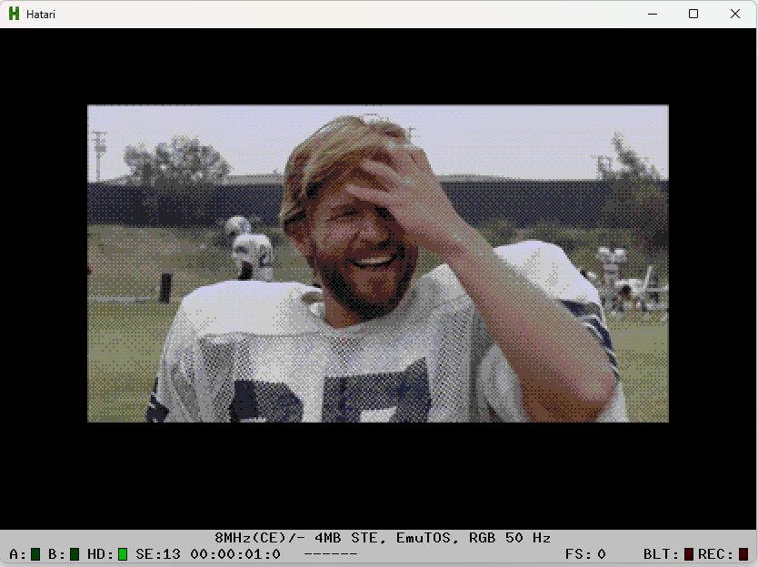
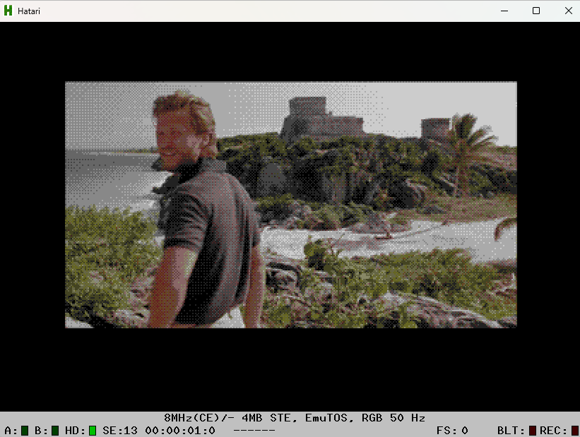
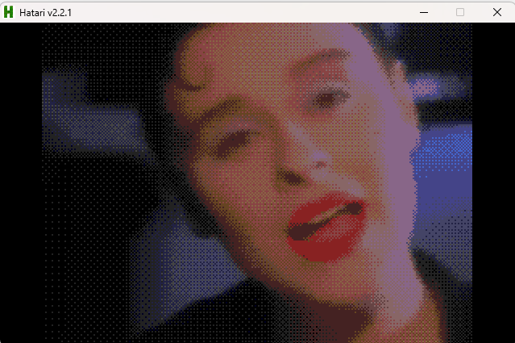

# ST Vidéo — PC-to-Atari ST video encoder

The idea is simple: take a video on your PC, convert it, then watch it on
an Atari ST with sound. That's what ST Vidéo is for.

I'm **David Ascenso**. I already had my own Atari video encoder and player.
I wanted to make them easier to use and improve the picture and sound,
while still running on an **8 MHz ST**.

The encoder runs on **Windows 10 and 11, in French and English**. It prepares
**320 × 200 video with 16 colours** and creates a file to copy to your Atari.
The **STFPLAY.PRG** player is included. Playback works on **ST, STF and STE
machines with 512 KB of RAM or more**, in PAL.

**[Download the installer or portable version](https://github.com/DDRCREW-PROG/STVideo/releases/latest)** · [Lire en français](README.md)

## A few screenshots

Here are the settings I use to prepare a video for the STF: an optimised
ST palette, fixed dithering, optimised STF audio and 12.5 fps.



Here are three examples of video playback in **Hatari**. The first two
screenshots show an **8 MHz STE with 4 MB of RAM**. These are emulator
screenshots; my test on a real STF with 1 MB is described below.







## How it runs on my STF

I tested the player on my **Atari STF with 1 MB of RAM**, using **ACSI storage
with an SD card**. The program also works with **512 KB**.

At **12.5 frames per second**, it runs well and looks surprisingly smooth.
At **25 fps**, playback slows down on my setup because the storage cannot
keep up. That's why I recommend starting with 12.5 fps on an STF.

The video still plays at its normal speed and keeps its original duration.
It simply displays fewer pictures each second.

The file needs about **410 kB/s at 12.5 fps**, or **819 kB/s at 25 fps**.
Even storage advertised at 800–900 kB/s can struggle once access delays and
the driver are taken into account. Hatari tests also used 8 MHz and 512 KB,
but an emulator cannot tell you how fast your real ACSI drive will be.

## Install it and try a clip

Choose a download from the [release page](https://github.com/DDRCREW-PROG/STVideo/releases/latest):

- **Setup.exe**: the Windows installer, with shortcuts and an uninstaller.
- **Windows-portable.zip**: extract the folder and run **STVideo.exe**.
- **sources.zip**: the source code if you want to see how it works or make changes.

Python and FFmpeg are included, so you don't need to install them separately.
Use **Langue / Language** at the top of the window to switch languages.
The application remembers your choice.

1. Choose a video on your PC. You can also try a video URL; support depends on the site.
2. For an STF, click **Recommended STF / ACSI settings**.
3. Choose an output folder and give the clip a short Atari name: **1 to 8 characters**.
4. Click **Try a 5-second preview** to check the result before converting the whole video.
5. Encode it, then copy **<NAME>.STV** and **STFPLAY.PRG** to your Atari drive.
6. Run **STFPLAY.PRG** in colour low resolution on a PAL Atari.

Five-second previews go into the **APERCU** subfolder. If a clip name already
exists, the encoder adds a number and keeps your previous files.

## Settings I recommend

For an STF, start with **12.5 fps**, **Fixed pattern (stable)** dithering,
**Optimised ST palette** and **Optimised STF audio (slower encoding)**.
The recommended-settings button chooses these for you.

“Slower encoding” means more preparation time on the PC. It does not slow
down playback on the Atari.

The optimised palette chooses 16 colours suited to the picture from the
**ST's 512 colours**. Dithering uses small patterns to make gradients look
smoother. **Fixed pattern** is a good starting point. For cartoons, text
and flat colours, try **No dithering** too. Compare a short preview: the
best-looking choice depends on the video.

**Sharper** can bring out detail. **Very sharp** goes further, but can add
obvious outlines or halos. Video noise reduction softens grain; turn it
down or off if it removes detail you want to keep.

## Which audio setting should I use?

On an **STF**, choose **Optimised STF audio**. The PC prepares the sound for
the Atari's YM2149 chip. This reduces some of the crackle, although it won't
sound as clean as an STE.

On an **STE**, choose **Optimised STE audio** to use its cleaner DMA audio
output. A clip encoded for STF still uses YM sound when played on an STE.
To get DMA sound, encode it again with the STE setting.

Start with **Light** audio cleanup. **Strong** may help a noisy recording,
but can remove treble too. Quiet-source boost raises low volume, with a
maximum gain of roughly +12 dB. **Lightweight YM** is experimental; I
recommend the optimised STF mode for normal use.

The STE still needs fast enough storage. You can choose 12.5 fps with STE
audio if your drive struggles at 25 fps.

## Playing a video on the Atari

- **Right Shift**: stop the video and choose another STV file.
- **Escape**: exit the player. Cancelling the file selector also exits.

The player opens **VIDEO.STV** if it finds it; otherwise, it asks you to
choose a file. Sound is already inside the **STV**. For Atari playback,
you only need that file and **STFPLAY.PRG**.

## Where do the files go, and how big are they?

Everything goes into the output folder you choose. The default is
**Videos/STVideo** inside your Windows user folder.

Play **<NAME>.STV** with STFPLAY. The encoder also creates a **LAV** export,
a **WAV** audio file, image previews and a **JSON** report containing your
settings. LAV export stays at **25 fps**, even when you choose 12.5 fps for STV.

Allow about **24.6 MB per minute at 12.5 fps**, or **49.2 MB per minute at
25 fps**, for the STV file. The other exports take additional space.
For a long film, use **Start** and **Duration** to create separate parts
before reaching the 2 GiB file limit. The player does not yet play split
parts automatically.

If a URL fails, try a video already stored on your PC. Local-file conversion
works without an Internet connection.

## Want to look under the hood?

The player is written in **68000 assembly**, and the encoder in **Python**,
using FFmpeg to prepare the video and sound. The PC does the heavy work;
the Atari reads pictures and audio already prepared for it.

- [STF guide](docs/GUIDE-STF.en.txt), also available inside the application.
- [Windows build instructions](docs/BUILD-WINDOWS.md).
- [STV format](docs/FORMAT-STV.md).
- [Tests and measurements](docs/VALIDATION.md).

With Python 3.12 x64 on Windows:

```powershell
python -m venv .venv
.venv\Scripts\python.exe -m pip install -r requirements-build.txt
.venv\Scripts\python.exe tools\app.py
.venv\Scripts\python.exe -m unittest discover -s tools -p "test_*.py"
.venv\Scripts\python.exe tools\build_windows.py --inno "C:\Program Files (x86)\Inno Setup 6\ISCC.exe"
```

The compiled Atari player is in `player/STFPLAY.PRG`, with its source in
`src/player.s`. Rebuild it with vasm using `tools/build.ps1 -Assembler <path>`.
The template `packaging/github-actions-windows.yml` is included if you want
to set up Windows builds in GitHub Actions. Install it in `.github/workflows/`
to activate it.

## Credits

**David Ascenso — ST Vidéo.** Source code is GPL-2.0-or-later: see
[LICENSE](LICENSE) and [third-party credits](THIRD_PARTY.md).
Thanks to Paulo Simoes for the measured YM level table distributed with Hatari.
Personal videos, emulators, TOS ROMs and legacy LAV players are not included.
The program's licence does not change the rights applying to your videos.
